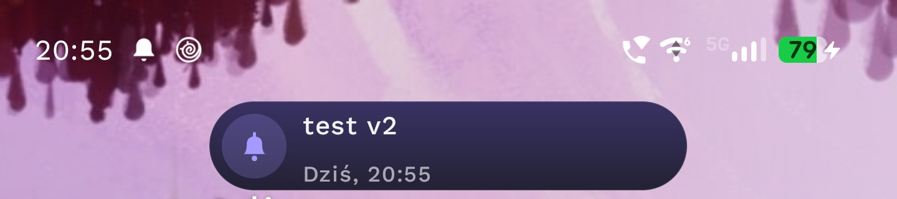
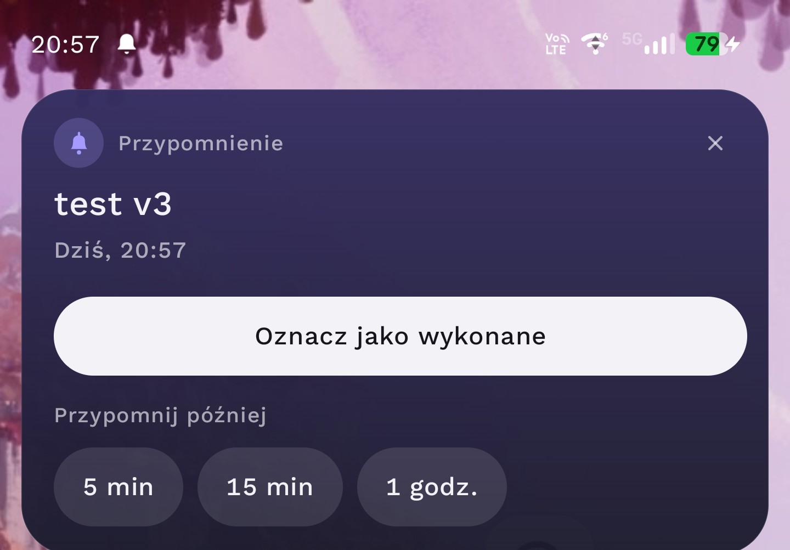
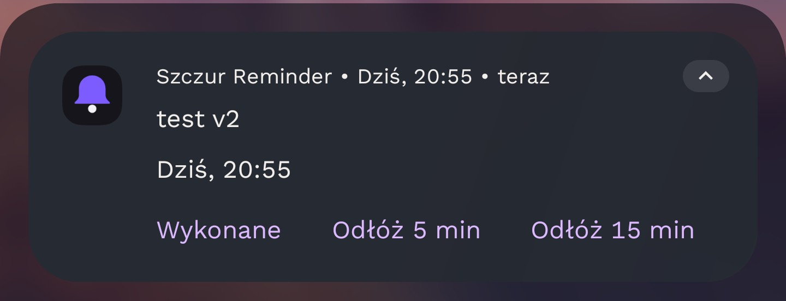

<div align="center">
  

  <h1>szczur reminder</h1>

  <p>Przypomnienia na Androida z opisem w Markdownie, niezawodnymi alarmami i natywną integracją ze <a href="https://github.com/szczurek9/szczur-media-bar">Szczur Media Bar</a>.</p>

</div>

Szczur Reminder działa **samodzielnie** (zwykłe powiadomienia Androida) i **nie wymaga** Szczur Media Bar. Gdy Media Bar jest zainstalowany,
przypomnienia pojawiają się na jego pasku: kompaktowa karta, po dotknięciu rozwinięcie z opisem i przyciskami „Wykonane” oraz „Przypomnij później”.
Zmiana trybu nie gubi przypomnień, nie dubluje alarmów i nie wymaga konfiguracji. Testowane na **Motorola Edge 70 Max, Android 16**.

## Screenshoty

| Ekran | Podgląd |
| :--- | :---: |
| **Lista przypomnień**<br>Kafelki posortowane po terminie; nadchodzące, przeterminowane i wykonane wyraźnie odróżnione. |  |
| **Nowe przypomnienie**<br>Tytuł, opis z podglądem Markdown, data, godzina i moment powiadomienia. |  |
| **Media Bar – karta kompaktowa**<br>Przypomnienie na pasku Szczur Media Bar. |  |
| **Media Bar – karta rozwinięta**<br>Pełny opis z Markdownem oraz przyciski akcji. |  |
| **Powiadomienie Androida**<br>Tryb bez Media Bar: „Wykonane” i „Odłóż”. |  |

## Funkcje

* **Przypomnienia** z tytułem (do 80 znaków), opisem (do 4000), datą i godziną; edycja, usuwanie, oznaczanie jako wykonane, osobna sekcja „Wykonane”.
* **Markdown** w opisie: `**pogrubienie**`, `*kursywa*`, `~~przekreślenie~~`, nagłówki, listy punktowane i numerowane, nowe linie. Zapisywany jest oryginalny tekst, formatowanie stosuje się przy wyświetlaniu. Bez HTML i linków.
* **Kiedy powiadomić:** o wybranej godzinie, 5 / 15 / 30 / 60 minut wcześniej albo 1 dzień wcześniej (np. termin 15:00 i „30 minut wcześniej” daje powiadomienie o 14:30).
* **Przypomnij później** z własnym zestawem interwałów (5 min, 10 min, 15 min, 30 min, 1 godz., 2 godz., 1 dzień).
* **Niezawodność:** dokładne alarmy (AlarmManager) działają przy zamkniętej aplikacji i zablokowanym ekranie; po restarcie telefonu, aktualizacji aplikacji oraz zmianie czasu lub strefy czasowej alarmy są odtwarzane. Powtórzony albo nieaktualny alarm nie daje drugiego powiadomienia.
* **Dźwięk i wibracja** w obu trybach (kanały powiadomień można dostroić w ustawieniach Androida).
* Material Design 3, kolory dynamiczne, tryb jasny i ciemny.

## Jak działają powiadomienia

| Sytuacja | Co się dzieje |
| :--- | :--- |
| **Media Bar dostępny** (zainstalowany, integracja włączona, ekran odblokowany) | Karta na pasku Media Bar na czas z ustawień (3–10 s, domyślnie 5 s) oraz wpis w centrum powiadomień bez baneru – zostaje po zniknięciu paska. Zniknięcie paska **nie** oznacza przypomnienia jako wykonanego. |
| **Media Bar niedostępny** (brak, wyłączony, błąd) albo **ekran zablokowany** | Zwykłe powiadomienie Androida z banerem, dźwiękiem i wibracją. Przyciski: „Wykonane” i dwa najkrótsze interwały odłożenia (system pokazuje maks. 3 akcje); dotknięcie otwiera szczegóły. |

Tryb jest wybierany dopiero w chwili alarmu, więc odinstalowanie Media Bar nigdy nie dotyka bazy ani zaplanowanych alarmów.

## Instalacja i budowanie

1. Zbuduj **oba** projekty na tym samym komputerze, tym samym kluczem podpisu (domyślny debug keystore wystarcza) – most do Media Bar używa uprawnienia typu *signature*.
2. [Szczur Media Bar](https://github.com/szczurek9/szczur-media-bar) w wersji **1.1.0+**: *Build → Build APK(s)* i instalacja.
3. Ten projekt: otwórz w Android Studio → *Build → Build APK(s)* i instalacja.
   Jeśli ustawienia pokazują „brak połączenia z mostem”, a Media Bar 1.1.0 jest zainstalowany, zainstaluj Reminder ponownie (uprawnienie signature przyznaje się przy instalacji).
4. Zezwól na powiadomienia (aplikacja poprosi przy pierwszym uruchomieniu). W Media Bar włącz dostęp do powiadomień i uprawnienie nakładki, jak dotychczas.

Testy jednostkowe: `./gradlew :app:testDebugUnitTest`. Lista testów ręcznych na urządzeniu: [docs/TESTING.md](docs/TESTING.md).

| Element | Wersja |
|---|---|
| minSdk / targetSdk / compileSdk | 36 / 36 / 36 (Android 16) |
| Android Gradle Plugin | 8.13.0 |
| Kotlin / KSP | 2.2.20 / 2.2.20-2.0.2 |
| Room / Navigation / Compose BOM | 2.8.1 / 2.9.5 / 2025.09.01 |

Android 17 (API 37): projekt celuje w API 36; zachowanie na 17 trzeba sprawdzić na urządzeniu.

### Zgodność wersji

| Szczur Reminder | Szczur Media Bar | Tryb |
|---|---|---|
| 1.0.0 | 1.1.0+ | pasek Media Bar (protokół v1) |
| 1.0.0 | 1.0.x lub brak | zwykłe powiadomienia Androida |

## Uprawnienia

| Uprawnienie | Po co |
|---|---|
| `POST_NOTIFICATIONS` | Pokazywanie przypomnień; prośba o zgodę przy pierwszym starcie, stan i skrót do ustawień w aplikacji. |
| `USE_EXACT_ALARM` | Punktualne alarmy. Przyznawane automatycznie aplikacjom typu kalendarz/alarm i niecofalne. Zakładam instalację poza Google Play (Play ogranicza to uprawnienie do aplikacji alarmowych i kalendarzowych). |
| `RECEIVE_BOOT_COMPLETED` | Odtworzenie alarmów po restarcie telefonu. |
| `VIBRATE` | Wibracja powiadomień. |
| `com.szczurek9.mediabar.permission.REMINDER_BRIDGE` | Most do Media Bar (*signature* – tylko aplikacje podpisane tym samym kluczem). |

## Architektura

```
app/src/main/java/com/szczurek9/reminder/
├── ReminderApp.kt                    Kontener zależności
├── data/                             Room: encja, DAO, repozytorium (interfejs + implementacja)
├── domain/                           Model, czas powiadomienia, walidacja, ReminderManager (baza + alarmy)
├── settings/                         DataStore: AppSettings, SettingsRepository
├── notifications/                    ReminderScheduler (AlarmManager), kanały, ReminderEngine, powiadomienia systemowe
├── integration/                      MediaBarClient (most), prezentery: MediaBarPresenter / ReminderPresenter
├── receivers/                        AlarmReceiver, ActionReceiver, BootReceiver
└── ui/                               Compose: lista, szczegóły, edytor, ustawienia, Markdown, motyw
```

* `ReminderManager` łączy bazę z alarmami i nie wie nic o sposobie prezentacji. `ReminderPresenter` ma dwie implementacje (Media Bar i powiadomienie systemowe); wybiera je `ReminderEngine` w chwili alarmu.
* Alarm to jeden `PendingIntent` na przypomnienie, więc ponowne planowanie nadpisuje, a nie dubluje. Atomowy `claimFire` w DAO odrzuca powtórzone i nieaktualne alarmy.
* Czas wydarzenia to data i godzina lokalna; moment powiadomienia jest przeliczany po zmianie strefy, czasu, restarcie i aktualizacji. Zaległe przypomnienia (telefon był wyłączony) pokazują się po starcie.
* Akcje z paska Media Bar wracają przez `PendingIntent`-y tej aplikacji, więc Reminder nie wystawia żadnego publicznego wejścia, które dałoby się podrobić.

Protokół mostu (v1) i lista zmian po stronie Media Bar: [docs/REMINDER_INTEGRATION.md w szczur-media-bar](https://github.com/szczurek9/szczur-media-bar/blob/main/docs/REMINDER_INTEGRATION.md).

## Ograniczenia

* Pasek Media Bar (nakładka) nie działa na ekranie blokady – wtedy zawsze jest zwykłe powiadomienie.
* Wymuszone zatrzymanie aplikacji kasuje alarmy; odtwarzają się po następnym uruchomieniu aplikacji lub restarcie.
* Wyłączenie „Powiadomienia włączone” w ustawieniach aplikacji powoduje, że alarm jest zużyty bez pokazania; przypomnienie zostaje na liście jako przeterminowane.

## Licencja

MIT – patrz [LICENSE](LICENSE).
